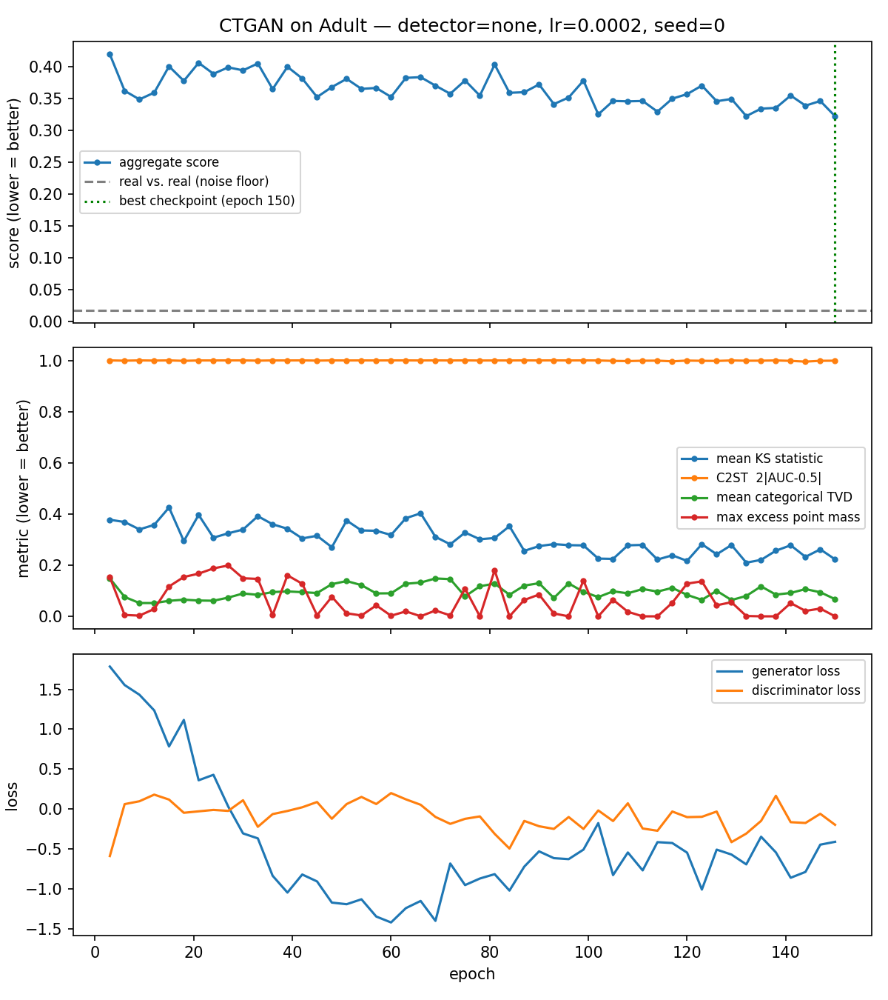

# Monitoring Synthetic Data Fidelity During CTGAN Training

**Research question:** can fidelity metrics computed *during* training detect when a tabular GAN (CTGAN) starts producing worse data, earlier and more reliably than loss curves or a fixed epoch budget?

CTGAN training is unstable. Sample quality does not improve monotonically with epochs, and failures such as mode collapse are usually found only after training finishes. This project trains CTGAN with a per-epoch hook that samples from the generator, scores the samples against held-out real data, keeps the best checkpoint, and optionally stops early when a change detector fires.

> Status: early-stage student research project. The monitoring code and metrics work; the experiments that would answer the research question (multiple datasets, seeds, induced failures, detector comparison) are in progress. See [Roadmap](#roadmap).

## What it does

```
train k epochs ─► sample synthetic rows ─► score vs. held-out real data ─► update detector
      ▲                                                                       │
      └──────────── continue (save checkpoint if best so far) ◄── no ─── alarm? ── yes ─► stop, restore best checkpoint
```

**Metrics** (all effect sizes; 0 = indistinguishable from real, higher = worse; see `validator.py`):

| Metric | Captures |
|---|---|
| KS statistic per numeric column | marginal distribution shape |
| Jensen–Shannon divergence (shared bins, base 2) | marginal distribution shape |
| Total variation distance per categorical column | category frequencies |
| Excess point mass | samples piling up on a single value (a common tabular-GAN failure) |
| Correlation-matrix distance | pairwise numeric relationships |
| Classifier two-sample test (C2ST) | joint structure: can a classifier tell real rows from synthetic? |

p-values are deliberately **not** used for decisions: with large samples a KS test rejects negligible differences, with small samples it accepts large ones, and repeatedly retraining until a test passes inflates false passes.

Every run also reports a **noise floor**: the same metrics computed between two samples of *real* data. A synthetic score near the floor is about as good as the metrics can detect.

**Detectors** (`monitor.py`): `none` (just keep the best checkpoint), `patience` (stop after no improvement for N checks), and `cusum` (one-sided CUSUM on degradation relative to the best score so far).

**Downstream utility:** a classifier is trained on synthetic data and tested on real held-out data (train-synthetic-test-real), compared with training on real data.

## Quick start

```bash
python -m venv .venv && source .venv/bin/activate
pip install -r requirements.txt

python run_experiment.py --epochs 100                 # baseline: log metrics, keep best checkpoint
python run_experiment.py --epochs 100 --detector cusum
python run_experiment.py --epochs 100 --lr 2e-3 --name high_lr   # try to induce degradation
```

The UCI Adult dataset downloads automatically on first run. Each run writes `metrics.csv`, `summary.json` and `fidelity_over_training.png` to `results/<name>/`.

## Example result

One run: CTGAN on 10,000 Adult rows, 150 epochs, default settings, seed 0, metrics every 3 epochs (`python run_experiment.py --epochs 150 --check-every 3 --name example`).



| | Aggregate score | Mean KS | C2ST | Accuracy (train on X, test on real) |
|---|---|---|---|---|
| Real vs. real (noise floor) | 0.017 | 0.015 | 0.03 | 0.875 (real) |
| CTGAN, final epoch 150 | 0.318 | 0.212 | 0.998 | 0.826 |

What this single run shows:

- **No collapse under default settings.** The score improves slowly and is still improving at epoch 150, so the best checkpoint is the last one. Studying degradation will require inducing it (e.g. higher learning rates).
- **The fidelity score is noisy from check to check**, and the excess-point-mass metric jumps between ~0 and ~0.2. Any change detector has to tolerate this noise, which is why CUSUM uses a drift term.
- **The classifier two-sample test is saturated:** a gradient-boosted classifier tells real from synthetic rows almost perfectly at every epoch. That makes it a strong overall verdict (the synthetic data is still easy to distinguish) but a poor *monitoring* signal, since it barely moves. A weaker classifier or a per-feature version may be more useful for tracking change.
- **Loss curves do not track fidelity.** Generator loss falls sharply during epochs 0–60 while the fidelity score barely changes.
- Downstream utility is reasonable: a classifier trained on synthetic data reaches 82.6% accuracy on real data versus 87.5% when trained on real data.

These are observations from a single seed and dataset, not conclusions.

## Files

| File | Purpose |
|---|---|
| `validator.py` | fidelity metrics and the aggregate score |
| `monitor.py` | per-epoch training hook, checkpointing, change detectors |
| `data.py` | Adult dataset download and loading |
| `run_experiment.py` | runs one experiment and writes results |
| `plot_results.py` | redraws a run's figure from its saved metrics |

## Roadmap

- [ ] Repeat runs across seeds and report variance
- [ ] Induce degradation deliberately (learning rate, batch size, category imbalance) and label its onset
- [ ] Compare detectors on detection delay, false alarms and compute saved
- [ ] Add more datasets (e.g. Covertype, a credit-default dataset)
- [ ] Study how to weight metrics in the aggregate score

## Limitations

- The aggregate score is an unweighted mean of metrics; the right combination is an open question.
- CUSUM drift and threshold values are hand-picked, not calibrated.
- The per-epoch hook relies on CTGAN's internal training loop, so the `ctgan` version is pinned.
- Results so far come from single runs on one dataset.

## References

- Xu et al., *Modeling Tabular Data using Conditional GAN*, NeurIPS 2019.
- Patki et al., *The Synthetic Data Vault*, IEEE DSAA 2016.
- Lopez-Paz & Oquab, *Revisiting Classifier Two-Sample Tests*, ICLR 2017.
- Page, *Continuous Inspection Schemes*, Biometrika 1954.
- Becker & Kohavi, *Adult* dataset, UCI Machine Learning Repository, 1996.

## Acknowledgments

The README and documentation of this code was created with the assistance of Claude

## License

GPL-3.0. See `LICENSE`.
