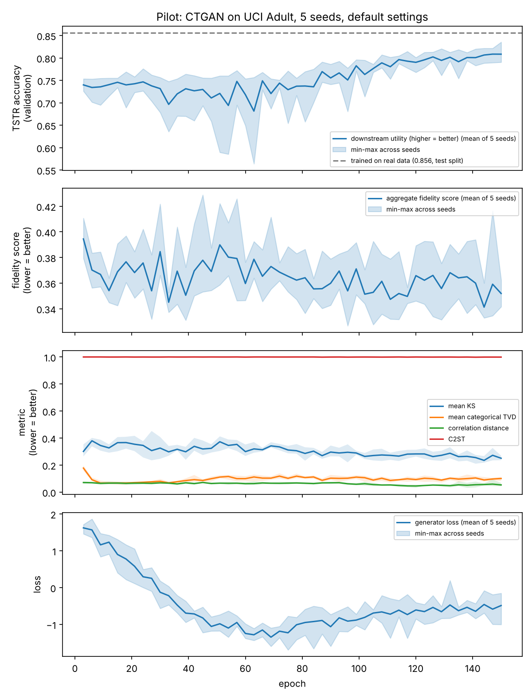

# Monitoring Synthetic Data Fidelity During CTGAN Training

**Research question:** can fidelity metrics computed *during* training detect when a tabular GAN (CTGAN) starts producing worse data, earlier and more reliably than loss curves or a fixed epoch budget?

CTGAN training is unstable. Sample quality does not improve monotonically with epochs, and failures such as mode collapse are usually found only after training finishes. This project trains CTGAN with a per-epoch hook that samples from the generator, scores the samples against held-out real data, keeps the best checkpoint, and optionally stops early when a change detector fires.

> Status: early-stage student research project. The monitoring code works and a 5-seed pilot on one dataset is done (below). Induced-failure regimes, more datasets, other model families and the detector comparison are next. See [Roadmap](#roadmap).

## What it does

```
train k epochs ─► sample synthetic rows ─► score vs. held-out real data ─► update detector
      ▲                                                                       │
      └──────────── continue (save checkpoint if best so far) ◄── no ─── alarm? ── yes ─► stop, restore best checkpoint
```

**Metrics** (all effect sizes; 0 = indistinguishable from real, higher = worse; see `validator.py`):

| Metric | Captures |
|---|---|
| KS statistic per numeric column | marginal distribution shape |
| Jensen–Shannon divergence (shared bins, base 2) | marginal distribution shape |
| Total variation distance per categorical column | category frequencies |
| Excess point mass | samples piling up on a single value (a common tabular-GAN failure) |
| Correlation-matrix distance | pairwise numeric relationships |
| Classifier two-sample test (C2ST) | joint structure: can a classifier tell real rows from synthetic? |

p-values are deliberately **not** used for decisions: with large samples a KS test rejects negligible differences, with small samples it accepts large ones, and repeatedly retraining until a test passes inflates false passes.

Every run also reports a **noise floor**: the same metrics computed between two samples of *real* data. A synthetic score near the floor is about as good as the metrics can detect.

**Detectors** (`monitor.py`): `none` (just keep the best checkpoint), `patience` (stop after no improvement for N checks), and `cusum` (one-sided CUSUM on degradation relative to the best score so far).

**Downstream utility:** a classifier is trained on synthetic data and tested on real held-out data (train-synthetic-test-real), compared with training on real data.

## Quick start

```bash
python -m venv .venv && source .venv/bin/activate
pip install -r requirements.txt

python run_experiment.py --epochs 100                 # baseline: log metrics, keep best checkpoint
python run_experiment.py --epochs 100 --detector cusum
python run_experiment.py --epochs 100 --lr 2e-3 --name high_lr   # try to induce degradation
```

The UCI Adult dataset downloads automatically on first run. Each run writes `metrics.csv`, `summary.json` and `fidelity_over_training.png` to `results/<name>/`.

## Pilot results

CTGAN on UCI Adult (10,000 rows, split 60/20/20 train/validation/test), default settings, 5 seeds, 150 epochs. Every 3 epochs, 2,000 synthetic rows are scored against the validation split, and downstream utility is measured as TSTR accuracy (train a classifier on the synthetic rows, test it on real validation rows).

```bash
for s in 0 1 2 3 4; do python run_experiment.py --epochs 150 --check-every 3 --seed $s --name pilot_s$s; done
python analyze_pilot.py results/pilot_s{0,1,2,3,4} --out results/pilot_summary
```



Spearman correlation with per-check TSTR (mean ± sd over 5 seeds). Metrics are "lower is better", so a useful one correlates negatively.

| Quantity | Levels | Check-to-check changes |
|---|---|---|
| Epoch number (time trend alone) | 0.75 ± 0.07 | — |
| Generator loss | 0.12 ± 0.10 | 0.04 ± 0.25 |
| Mean KS statistic | −0.55 ± 0.12 | −0.08 ± 0.15 |
| Mean JSD | −0.63 ± 0.08 | 0.01 ± 0.14 |
| Correlation distance | −0.54 ± 0.12 | −0.00 ± 0.07 |
| C2ST | −0.47 ± 0.13 | −0.18 ± 0.21 |
| Aggregate fidelity score | −0.23 ± 0.13 | 0.04 ± 0.10 |

What the pilot shows:

- **Losses don't track utility.** Generator loss falls steeply for ~70 epochs while TSTR stays flat near 0.73; TSTR then rises to ~0.81 while the loss climbs back up.
- **Several fidelity metrics track utility over a whole run, but no better than the epoch number does.** Most of the agreement is a shared time trend.
- **No metric tracks check-to-check changes in utility.** Part of this is probably noise in per-check TSTR (2,000 synthetic rows).
- **The naive aggregate score is the weakest signal.** Averaging in metrics that don't track utility (categorical TVD, excess point mass) dilutes the ones that do. C2ST is saturated near 1 throughout.
- **Restoring the best-scoring checkpoint was worse than keeping the final epoch** (test TSTR 0.795 vs 0.812 on average; worse in 4 of 5 seeds). Training on real data gives 0.856. At default settings quality was still improving at epoch 150, so there was no degradation to detect.

Takeaway: the default setting is the easy case. Comparing stopping rules only makes sense where quality actually degrades, so induced-failure and fragile regimes come next.

## Files

| File | Purpose |
|---|---|
| `validator.py` | fidelity metrics and the aggregate score |
| `monitor.py` | per-epoch training hook, checkpointing, change detectors |
| `data.py` | Adult dataset download and loading |
| `run_experiment.py` | runs one experiment and writes results |
| `plot_results.py` | redraws a run's figure from its saved metrics |
| `analyze_pilot.py` | aggregates several runs: correlations with utility, checkpoint selection, summary figure |

## Roadmap

- [x] Pilot: 5 seeds on Adult with per-check downstream utility
- [ ] Estimate how much of per-check TSTR variation is sampling noise
- [ ] Induce degradation deliberately (learning rate, batch size, category imbalance) and label its onset
- [ ] Compare detectors on detection delay, false alarms and compute saved
- [ ] Add more datasets (e.g. Covertype, a credit-default dataset)
- [ ] Study how to weight metrics in the aggregate score

## Limitations

- The aggregate score is an unweighted mean of metrics; the right combination is an open question.
- CUSUM drift and threshold values are hand-picked, not calibrated.
- The per-epoch hook relies on CTGAN's internal training loop, so the `ctgan` version is pinned.
- Results so far come from one dataset, one model (CTGAN) and default settings.

## References

- Xu et al., *Modeling Tabular Data using Conditional GAN*, NeurIPS 2019.
- Patki et al., *The Synthetic Data Vault*, IEEE DSAA 2016.
- Lopez-Paz & Oquab, *Revisiting Classifier Two-Sample Tests*, ICLR 2017.
- Page, *Continuous Inspection Schemes*, Biometrika 1954.
- Becker & Kohavi, *Adult* dataset, UCI Machine Learning Repository, 1996.

## Acknowledgments

The README and documentation of this code was created with the assistance of Claude

## License

GPL-3.0. See `LICENSE`.
